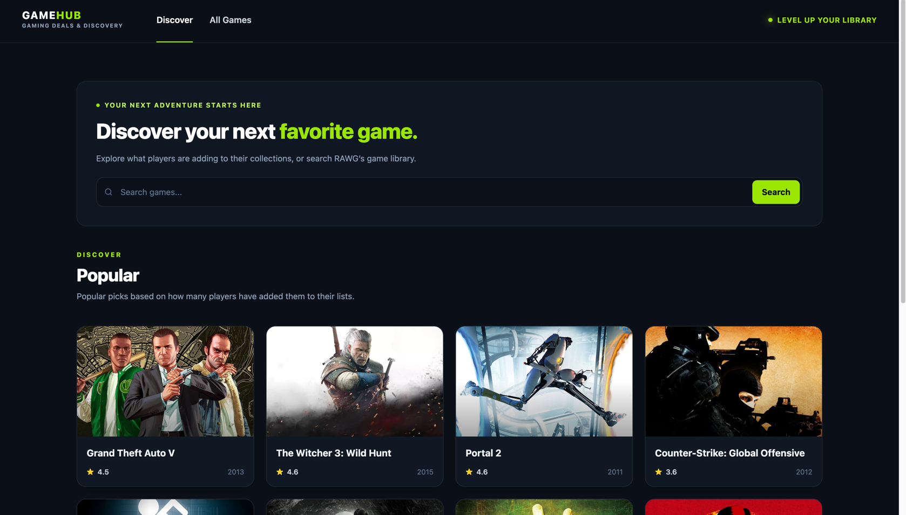
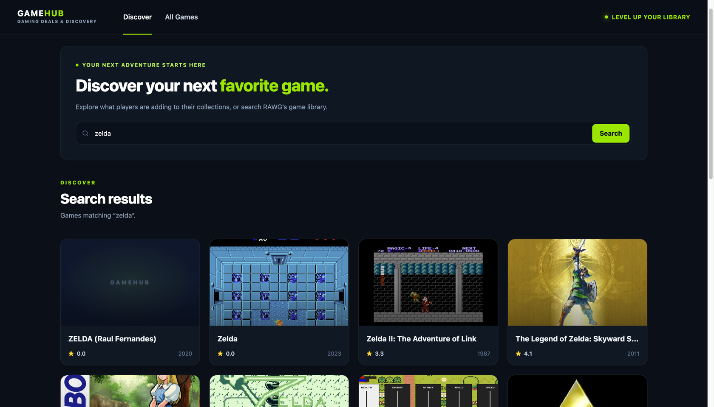
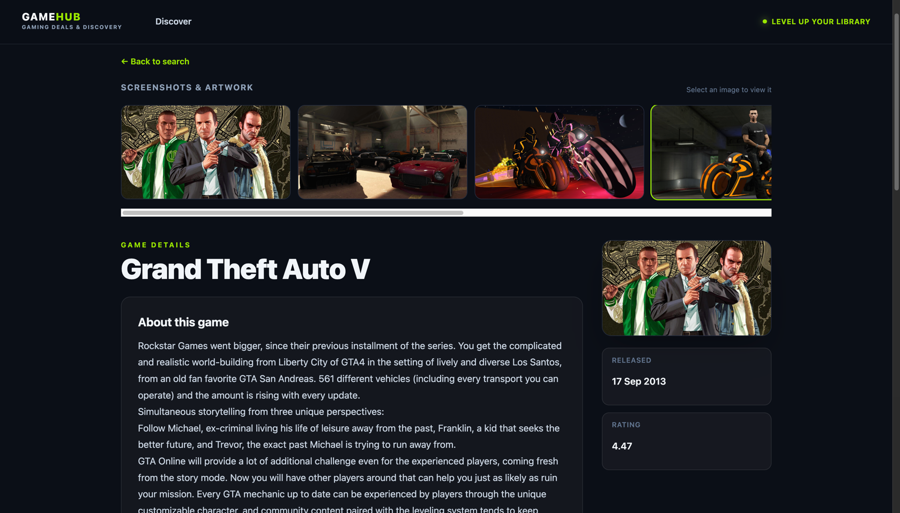
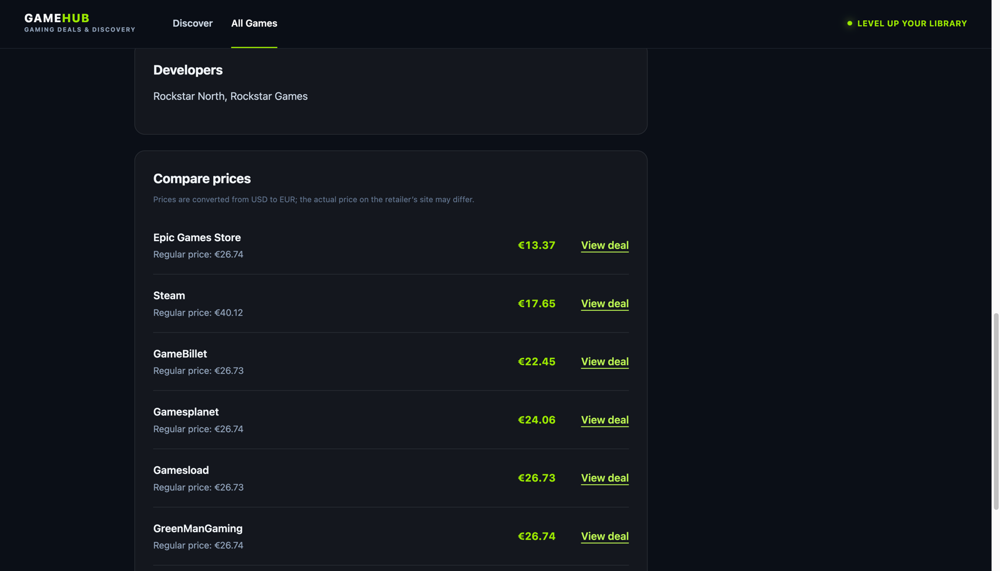

# GameHub

GameHub is a Blazor web app for discovering games and comparing current game deals. Browse popular games or search RAWG's catalogue, open a game's details and screenshots, and compare retailer offers with prices converted from USD to EUR.

## Features

- Browse full game catalogue with pagination.
- Search for games by title.
- View game descriptions, release dates, ratings, developers, artwork, and screenshots.
- Compare available deals from CheapShark, with prices converted to EUR using Frankfurter exchange rates.
- Click on a deal to open the retailer's website in a new tab.
- Responsive interface built with Blazor and Tailwind CSS.

## Preview Screenshots





## Requirements

- [.NET 10 SDK](https://dotnet.microsoft.com/download/dotnet/10.0)
- [Node.js and npm](https://nodejs.org/) (for the Tailwind CSS development workflow)
- A [RAWG API key](https://rawg.io/apidocs)

## Setup

From the repository root, save your RAWG API key with .NET user secrets:

```sh
dotnet user-secrets set "Rawg:ApiKey" "YOUR_RAWG_API_KEY" --project SOA_CA1/SOA_CA1.csproj
```

Install the frontend development dependencies:

```sh
cd SOA_CA1
npm install
```

## Run locally

From the `SOA_CA1` directory, start the app and Tailwind CSS watcher together:

```sh
npm run dev
```

The app uses the launch settings in `Properties/launchSettings.json`; the default addresses are `http://localhost:5208` and `https://localhost:7226`.

To build the app without the development watchers, run from the repository root:

```sh
dotnet build SOA_CA1.sln
```

## Run tests

Run the API client tests from the repository root:

```sh
dotnet test SOA_CA1.sln
```

## Project structure

```text
SOA_CA1/
  ApiClients/       RAWG, CheapShark, and Frankfurter API integrations
  Components/       Blazor pages and layout
  Models/           Game, deal, and exchange-rate models
  Styles/           Tailwind CSS input
  wwwroot/          Static assets and generated CSS
SOA_CA1.Tests/      API client tests
```

## Data sources

- [RAWG](https://rawg.io/apidocs) provides game catalogue, detail, and screenshot data. It requires the API key configured above.
- [CheapShark](https://apidocs.cheapshark.com/) provides deal listings.
- [Frankfurter](https://www.frankfurter.app/docs/) provides the USD-to-EUR exchange rate.

Deal prices are converted from USD to EUR for display. The final price on a retailer's website may differ.
